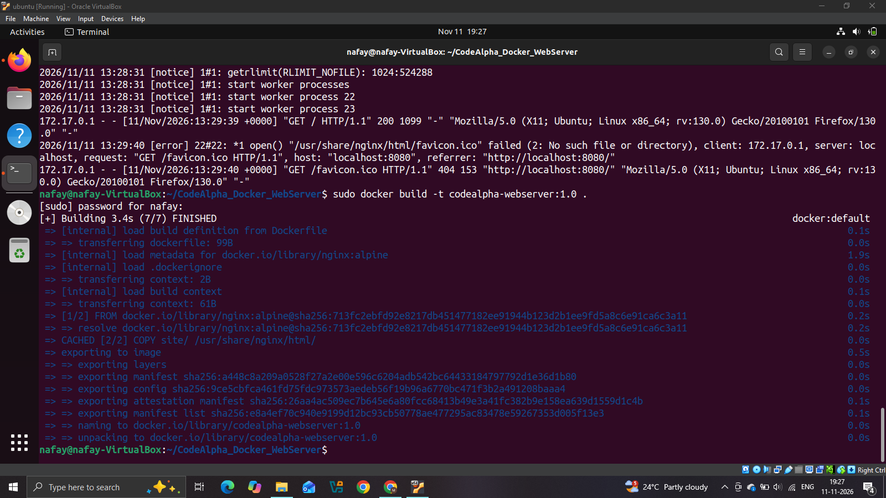
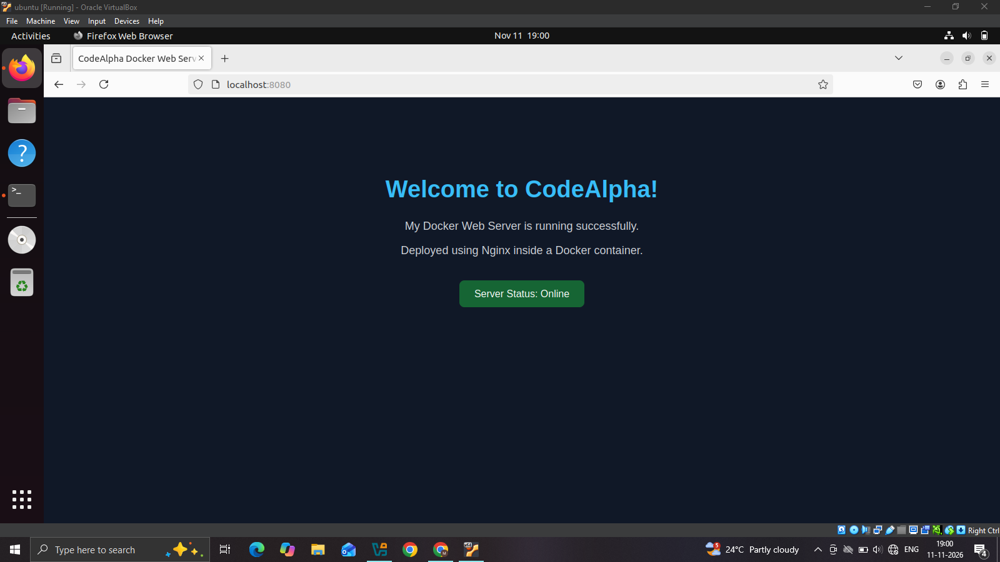
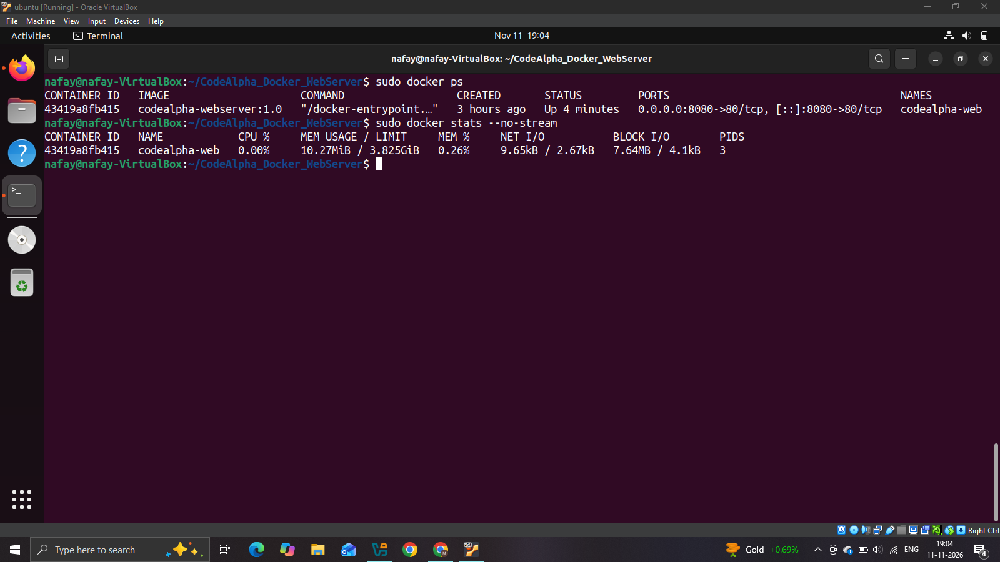
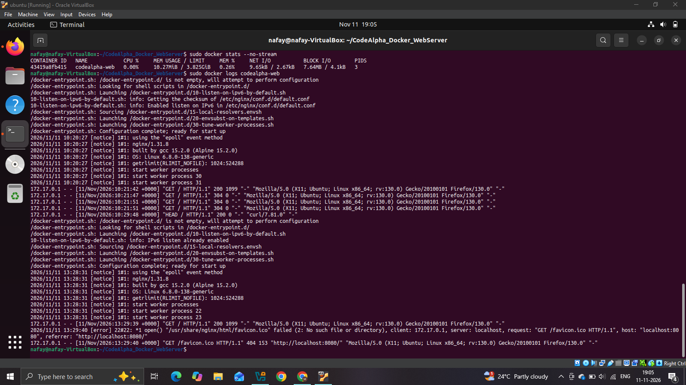

# CodeAlpha Docker Web Server

## Project Overview
This project demonstrates how to build, deploy, and monitor a custom static website using Nginx inside a Docker container.

## Objective
To deploy a lightweight web server using Docker and verify its availability through browser access and container monitoring.

## Technologies Used
- Ubuntu 22.04 LTS
- Docker Engine
- Nginx (Alpine image)
- HTML and CSS
- Git and GitHub

## Project Structure
```text
CodeAlpha_Docker_WebServer/
├── Dockerfile
├── README.md
└── site/
    └── index.html
```

## Dockerfile
```dockerfile
FROM nginx:alpine
COPY site/ /usr/share/nginx/html/
EXPOSE 80
```

## Build Docker Image
```bash
sudo docker build -t codealpha-webserver:1.0 .
```

## Run Docker Container
```bash
sudo docker run -d --name codealpha-web -p 8080:80 codealpha-webserver:1.0
```

## Access the Website
Open the following URL in a browser:

`http://localhost:8080`

The custom CodeAlpha webpage should appear.

## Monitoring the Container

Check running containers:
```bash
sudo docker ps
```

Monitor resource usage:
```bash
sudo docker stats --no-stream
```

View container logs:
```bash
sudo docker logs codealpha-web
```

Check container health status:
```bash
sudo docker inspect --format='{{.State.Status}}' codealpha-web
```

Test HTTP response:
```bash
curl -I http://localhost:8080
```

## Results
- Successfully built a custom Docker image.
- Deployed an Nginx web server inside a Docker container.
- Accessed the website through the browser.
- Verified container status and resource usage.
- Monitored server activity through Docker logs.

## Project Outcome
Successfully deployed and monitored a custom Nginx web server using Docker.

## Author
Syed Abdul Nafay

## Internship
CodeAlpha - DevOps Internship


## Project Screenshots

### 1. Docker Image Build


### 2. Running Website


### 3. Container Status


### 4. Docker Monitoring


### 5. Docker Logs

